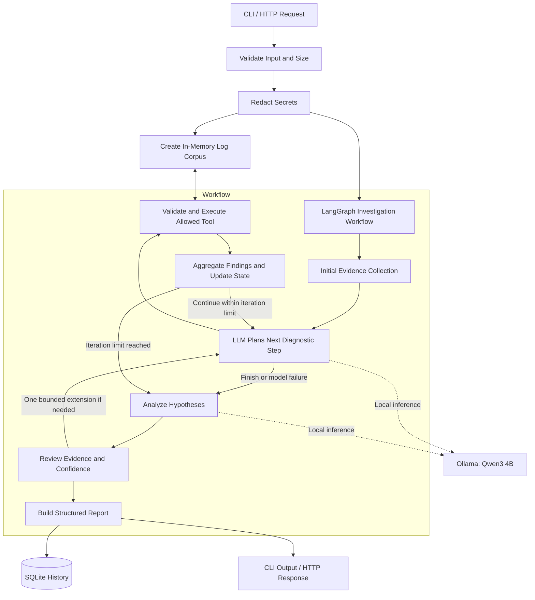

# Sentinel AI — Autonomous Incident Investigation Agent

**A local-first AI agent that investigates application logs, gathers evidence, evaluates root-cause hypotheses, and recommends next diagnostic steps.**

Sentinel AI is a read-only incident investigation agent built with Python, LangGraph, Pydantic, and Ollama. It uses a local LLM (`qwen3:4b`) to guide diagnostic tool selection, propose explanations, and generate structured incident reports.

Unlike a basic log summarizer, Sentinel separates observed facts from hypotheses, validates evidence references, limits unsupported confidence, and explicitly identifies unknowns. Suggested remediation is informational only and is never executed automatically.

- **Local-first:** No paid API or API key required.
- **Evidence-driven:** Diagnostic findings reference specific log evidence.
- **Read-only:** No shell execution, database modification, or automatic remediation.
- **Inspectable:** Tool calls and investigation results are recorded for review.

> [!IMPORTANT]
> **Verification status:** This project has not yet been fully verified against all real dependencies and a live Ollama model. Some development tests used temporary stand-ins because the build environment could not install the required packages. See [Verification Status](#verification-status) before relying on the results.

## Table of Contents

- [Why Sentinel AI?](#why-sentinel-ai)
- [Features](#features)
- [Architecture](#architecture)
- [Technology Stack](#technology-stack)
- [Requirements](#requirements)
- [Installation](#installation)
- [Usage](#usage)
- [Testing and Evaluation](#testing-and-evaluation)
- [Safety and Security](#safety-and-security)
- [Known Limitations](#known-limitations)
- [Roadmap](#roadmap)
- [Verification Status](#verification-status)
- [Contributing](#contributing)
- [License](#license)

## Why Sentinel AI?

Application incidents often produce hundreds of log lines, but identifying the underlying cause requires more than summarization. Engineers must correlate events, trace requests, investigate competing explanations, and determine what evidence is still missing.

Sentinel AI aims to make this workflow more systematic.

Its investigation process combines deterministic diagnostic tools with LLM-guided reasoning. The model proposes what to investigate, while the application validates tool requests, gathers evidence, reviews hypotheses, and generates a structured report.

The goal is not to pretend that an LLM always knows the answer. It is to help engineers investigate incidents while making uncertainty visible.

## Features

- **Log ingestion:** CLI file input and HTTP JSON requests, with input-size limits.
- **Secret redaction:** Applies heuristic redaction before logs reach the model or persistent investigation storage.
- **Five deterministic diagnostic tools:**
  - `search_logs`
  - `summarize_errors`
  - `trace_request`
  - `find_time_window`
  - `extract_error_context`
- **LangGraph orchestration:** Explicit investigation state, conditional routing, bounded tool execution, analysis, review, and report generation.
- **Evidence-aware reporting:** Structured reports validated with Pydantic.
- **Hypothesis review:** Reviews proposed explanations against available evidence and limits unsupported confidence.
- **Graceful degradation:** Produces a clearly labelled low-confidence report when the model is unavailable or returns unusable output.
- **Audit trail:** Records diagnostic tool calls, arguments, outcomes, and execution durations.
- **Persistent history:** Stores investigation reports and tool history in SQLite.
- **Multiple interfaces:** Command-line interface and FastAPI service.
- **Docker support:** Includes a Docker image build configuration.
- **Deterministic evaluation:** Supports baseline checks without requiring an LLM.

## Architecture



The diagnostic tools are deterministic functions operating on the investigation's in-memory log corpus. The LLM helps select tools and propose hypotheses; application code controls validation, execution limits, evidence handling, and report structure.

For implementation details, see:

- [Architecture](docs/architecture.md)
- [Threat Model](docs/threat-model.md)
- [Interview Guide](docs/interview-guide.md)

## Technology Stack

| Technology | Purpose |
|---|---|
| Python 3.11+ | Core application |
| LangGraph | Investigation workflow orchestration |
| Ollama | Local LLM inference |
| Qwen3 4B | Local reasoning and structured responses |
| LangChain Ollama integration | Chat model client |
| Pydantic | Data validation and structured reports |
| SQLite | Investigation history and tool-call audit trail |
| FastAPI | HTTP API |
| pytest | Automated tests |
| Ruff | Linting and formatting |
| Docker | Container packaging |

### Design Decisions

- **Local inference:** Keeps model inference on the user's machine without requiring a paid hosted API.
- **Deterministic tools:** Makes log searches and request tracing reproducible and easier to test.
- **Structured outputs:** Uses validated data models instead of trusting arbitrary model-generated text.
- **Bounded orchestration:** Limits investigation iterations and review-triggered extensions.
- **SQLite:** Avoids requiring a separate database service for local usage.
- **No vector database in the initial version:** Exact log searches and deterministic filters are sufficient for the current scope.

A smaller model has limited reasoning capability. Sentinel therefore combines model-guided investigation with deterministic application logic rather than treating the model's conclusions as ground truth.

## Requirements

- Linux, macOS, or Windows with a compatible Python environment.
- Python 3.11 or newer.
- [Ollama](https://ollama.com/) for live model inference.
- Sufficient memory for the selected local model.
- Git for cloning the repository.

The `qwen3:4b` model is the recommended starting point. Actual RAM/VRAM use and performance depend on quantization, context length, Ollama configuration, and the hardware available.

## Installation

### 1. Install Ollama

Follow the official [Ollama installation instructions](https://ollama.com/download).

On Linux, the official installation script is also available:

```bash
curl -fsSL https://ollama.com/install.sh | sh
```

Pull the recommended model:

```bash
ollama pull qwen3:4b
```

Check that Ollama is responding:

```bash
ollama list
```

### 2. Clone the repository

```bash
git clone https://github.com/YOUR_USERNAME/sentinel-ai.git
cd sentinel-ai
```

Replace `YOUR_USERNAME` with the GitHub account that hosts this repository.

### 3. Create a Python environment

On Linux:

```bash
python3 -m venv .venv
source .venv/bin/activate
```

If your distribution's default Python is older than 3.11, install a compatible Python version first.

### 4. Install the project

```bash
python -m pip install --upgrade pip
python -m pip install -e ".[dev]"
```

### 5. Configure optional settings

Copy the example environment file if you need to customize settings:

```bash
cp .env.example .env
```

Edit `.env` as needed. Keep real credentials and private configuration out of Git.

### 6. Check the environment

```bash
sentinel doctor
```

The diagnostic command should report whether Ollama is available and whether the configured model can be found. Exact output depends on the environment.

## Usage

### Command-Line Interface

Investigate a log file:

```bash
sentinel investigate \
  --file data/sample_app.log \
  --question "Why are checkout requests failing?"
```

Add investigation metadata:

```bash
sentinel investigate \
  --file data/sample_app.log \
  --question "Why are checkout requests failing?" \
  --meta service=checkout \
  --json
```

View investigation history:

```bash
sentinel history
```

Inspect a previous investigation:

```bash
sentinel show <investigation_id>
```

Run deterministic evaluation:

```bash
sentinel eval
```

Run the evaluation with live Ollama inference:

```bash
sentinel eval --live
```

Live inference results and performance have not yet been established by the initial sandbox verification.

### HTTP API

Start the service:

```bash
sentinel serve --port 8000
```

If startup succeeds, the interactive API documentation is available at:

`http://127.0.0.1:8000/docs`

Check service health:

```bash
curl -s http://127.0.0.1:8000/health
```

Submit an investigation:

```bash
curl -s -X POST http://127.0.0.1:8000/investigations \
  -H 'Content-Type: application/json' \
  -d "$(python -c 'import json; print(json.dumps({
    "question": "Why are checkouts failing?",
    "log_text": open("data/sample_app.log").read()
  }))')"
```

The example assumes the API accepts the `question` and `log_text` fields shown above.

The documented response categories are:

| Status | Meaning |
|---|---|
| `201` | Investigation created |
| `404` | Investigation not found |
| `413` | Input exceeds the configured size limit |
| `422` | Invalid request body |
| `500` | Generic server error |

Confirm actual responses against the running application before relying on these behaviors.

### Docker

Build the image:

```bash
docker build -t sentinel-ai .
```

Run the API container:

```bash
docker run --rm \
  -p 8000:8000 \
  --add-host=host.docker.internal:host-gateway \
  sentinel-ai
```

The intended setup keeps Ollama on the host. Container-to-host connectivity and GPU access may require additional configuration depending on the operating system.

## Testing and Evaluation

Run the automated test suite:

```bash
pytest
```

Check code quality:

```bash
ruff check .
ruff format --check .
```

Run the deterministic evaluation:

```bash
sentinel eval
```

For live evaluation:

```bash
sentinel eval --live
```

A useful evaluation should distinguish between:

- Correct root-cause identification.
- Valid and relevant evidence citations.
- Appropriate confidence and uncertainty.
- Correct diagnostic tool selection.
- Unnecessary tool calls.
- Investigation latency and resource consumption.
- Behavior when the model or tools fail.

A passing deterministic baseline does not establish live LLM accuracy. Evaluation results should be published only after they have been reproduced and measured.

## Safety and Security

Sentinel AI is designed to be **read-only by construction**.

- Its diagnostic tools query the current log corpus rather than executing arbitrary commands.
- It has no shell, SQL execution, filesystem exploration, or arbitrary network-access tool in the investigation toolset described here.
- Tool selection is restricted to an allow-list with argument validation.
- Input is size-limited, and secret redaction is applied before model analysis.
- Logs are treated as untrusted input, including lines that resemble instructions.
- Proposed remediation is informational and requires human review.
- Tool activity is recorded for later inspection.

### Important Security Limitations

Redaction is heuristic and can miss unusual secret formats. A small model may still be influenced by malicious or instruction-like log content, even when evidence checks are applied.

Evidence-reference validation does not prove that a cited line semantically supports a claim.

The API should be bound to localhost for local use unless authentication, access controls, and deployment hardening have been implemented and verified.

Do not use the initial version as an autonomous production-remediation system.

## Known Limitations

- The local model may select an unhelpful diagnostic tool or propose a weak hypothesis.
- Evidence checks validate citation existence but do not fully establish semantic support.
- The initial evaluation dataset is small and synthetic.
- The supported log format expects an ISO-style timestamp and severity level; other formats may have reduced parsing accuracy.
- Log data is held in memory, with a default input-size limit of 2 MB.
- Investigations run synchronously; there is no built-in job queue.
- The initial API design does not provide authentication.
- Real-model latency, inference reliability, and GPU memory consumption have not yet been benchmarked.
- Full compatibility with the real LangGraph, FastAPI, and testing dependencies must be confirmed in a normal development environment.

## Roadmap

- [ ] Verify the complete application against real dependencies.
- [ ] Run and publish reproducible live evaluation results for Qwen3 4B.
- [ ] Compare Qwen3 4B and 8B under documented hardware and context settings.
- [ ] Implement semantic evidence verification.
- [ ] Expand the incident benchmark with known root causes and ambiguous cases.
- [ ] Add JSON Lines and logfmt parsing.
- [ ] Improve handling of contradictory evidence and prompt-injection attempts.
- [ ] Evaluate tool-call efficiency and latency across repeated runs.
- [ ] Add authentication and an asynchronous job queue before considering broader API deployment.
- [ ] Explore a human-approved remediation workflow as a separate, gated capability.

## Verification Status

The initial build was developed in a sandbox that could not install several required packages and did not have Ollama or a GPU available.

### Observed in the build sandbox

- Ruff linting and format checks completed successfully.
- 56 tests passed, with one API test file skipped because FastAPI was unavailable.
- Temporary local stand-ins for pytest and LangGraph were used to exercise a subset of the code.
- The deterministic evaluation reported 7/7 cases passing its baseline checks through the stand-in graph.
- The CLI investigation and history paths ran against SQLite in degraded, no-LLM mode.

### Not yet verified in that environment

- Graph execution with the real LangGraph package.
- A normal pytest run using the actual dependencies.
- FastAPI and HTTPX API tests.
- Live inference using `qwen3:4b`.
- Real-model output quality, latency, and GPU memory use.
- End-to-end operation of the API, Docker image, and Ollama health checks.

**No live-model accuracy claims are made.** The reported 7/7 baseline result measures the deterministic pipeline under the stand-in environment and uses intentionally lenient checks. It should not be interpreted as 100% root-cause accuracy.

## Contributing

Contributions, bug reports, and suggestions are welcome.

1. Fork the repository.
2. Create a feature branch.
3. Add or update tests for your changes.
4. Run the available test and lint checks.
5. Submit a pull request describing the change and its verification.

Please do not submit private logs, credentials, or other sensitive information in issues or test fixtures.

## License

If this repository includes an MIT `LICENSE` file, this project is distributed under the MIT License. Otherwise, add and verify the intended license before claiming that the project is MIT-licensed.
