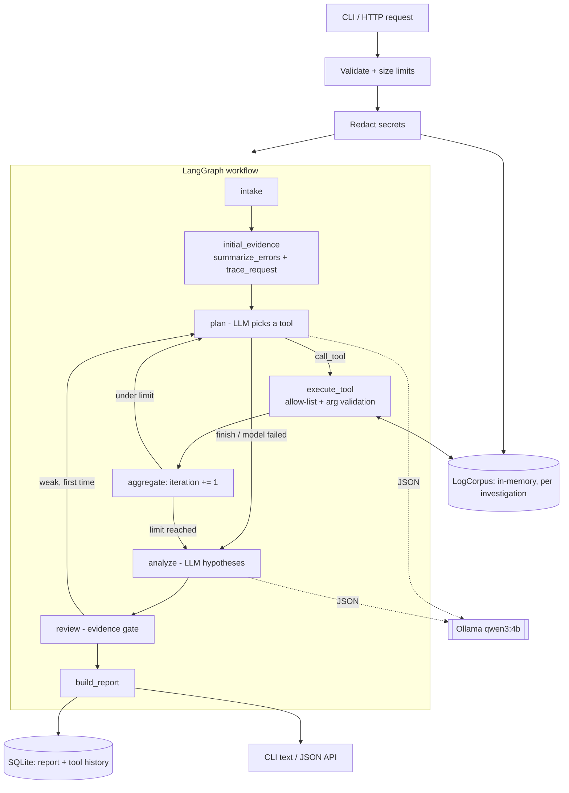

# Sentinel AI — Autonomous Incident Investigation Agent

A **read-only** agent that investigates application logs like an on-call engineer: it collects
evidence with deterministic diagnostic tools, lets a local LLM (Ollama, `qwen3:4b`) choose which
tool to run next, proposes root-cause hypotheses, **reviews them against the evidence**, and writes
a structured report that separates verified facts from suggestions. No paid API or API key is
needed anywhere.

> **Verification status (read this first).** The code was written and tested in a sandbox that
> could not install `langgraph`, `langchain-ollama`, `fastapi`, `pytest` or `httpx` (package index
> blocked) and had no Ollama or GPU. See [What has and has not been verified](#what-has-and-has-not-been-verified).
> Run the commands in [Setup](#setup-zorin-os--ubuntu) on your machine to confirm everything end to end.

## Why this exists

Log summarisation is easy; trustworthy investigation is not. A model that sees a wall of logs will
happily invent a cause. Sentinel AI makes the model *earn* its conclusions: every claim must cite
evidence ids that exist in the logs, confidence is capped by the evidence rather than self-reported,
and the report says so when the logs cannot answer the question.

## Features

- **Ingestion**: CLI file input or HTTP JSON body, size limits (rejects, never silently truncates),
  secret redaction before anything reaches the model or the database.
- **Five deterministic tools**: `search_logs`, `summarize_errors`, `trace_request`,
  `find_time_window`, `extract_error_context`. Pure functions over one in-memory corpus.
- **LangGraph workflow**: intake → initial evidence → plan ⇄ execute → analyze → review → report,
  with an iteration bound and one bounded review-triggered extension.
- **Evidence-gated reports** (Pydantic): summary, symptoms, cited log excerpts, root cause,
  alternatives, confidence + explanation, next diagnostic steps, remediation (marked unverified),
  unknowns.
- **Graceful degradation**: if Ollama is down or returns junk, you still get a deterministic,
  clearly labelled, low-confidence report instead of a crash.
- **Audit trail**: every tool call (including rejected ones) stored with arguments and duration.
- **SQLite history**, FastAPI service, CLI, Docker image, deterministic evaluation suite.

## Architecture



Details: [docs/architecture.md](docs/architecture.md) · Threats: [docs/threat-model.md](docs/threat-model.md) ·
Interview prep: [docs/interview-guide.md](docs/interview-guide.md)

## Technology choices and trade-offs

| Choice | Why | Trade-off |
|---|---|---|
| **qwen3:4b** (Q4, ~2.5 GB) | Fits a 6 GB RTX 4050 with an 8k context window and supports structured output | Small model: weaker reasoning; hence the deterministic evidence gate |
| JSON-mode prompting, not native tool-calling | Works with any Ollama model; every call is validated by Pydantic anyway | Slightly more prompt text |
| LangGraph | Explicit state, conditional edges, testable nodes | Extra dependency; nodes are plain methods so logic is testable without it |
| `langchain-ollama` only for the chat client | One clear use | — |
| SQLite, stdlib `argparse` | Zero infrastructure | Single-writer; fine for a local tool |
| No vector DB / Redis / frontend | Logs are searched exactly; none needed in v1 | Semantic search over huge corpora is out of scope |

Model size: `qwen3:8b` (~5 GB Q4) technically loads in 6 GB but leaves little room for the KV cache
and slows down sharply; start with 4b and benchmark 8b yourself if you want.

## Setup (Zorin OS / Ubuntu)

```bash
# 1. Ollama (local inference) and the model
curl -fsSL https://ollama.com/install.sh | sh
ollama pull qwen3:4b

# 2. Project
cd sentinel-ai
python3 -m venv .venv && source .venv/bin/activate
pip install -e ".[dev]"

# 3. Check everything is wired up
sentinel doctor          # "Ollama is up and model 'qwen3:4b' is available"
```

Python 3.11+ is required (Zorin OS 17 ships 3.10; install 3.11/3.12 via
`sudo apt install python3.12 python3.12-venv`, or use `pyenv`). Copy `.env.example` to change
settings; all are optional.

## Usage

### CLI

```bash
sentinel investigate --file data/sample_app.log --question "Why are checkout requests failing?"
sentinel investigate --file data/sample_app.log --question "..." --meta service=checkout --json
sentinel history
sentinel show <id>
sentinel eval            # deterministic baseline, no LLM needed
sentinel eval --live     # same cases, using Ollama
```

### API

```bash
sentinel serve --port 8000        # docs at http://127.0.0.1:8000/docs

curl -s localhost:8000/health
curl -s -X POST localhost:8000/investigations -H 'content-type: application/json' \
  -d "$(python3 -c 'import json;print(json.dumps({"question":"Why are checkouts failing?","log_text":open("data/sample_app.log").read()}))')"
curl -s localhost:8000/investigations/<id>
```

Status codes: `201` created, `404` unknown id, `413` input over the size limit, `422` invalid body,
`500` generic message only (details are logged server-side, never returned).

### Docker

```bash
docker build -t sentinel-ai .
docker run --rm -p 8000:8000 --add-host=host.docker.internal:host-gateway sentinel-ai
```
Ollama stays on the host (GPU access from containers needs extra setup not covered here).

## Testing

```bash
pytest              # unit + graph tests; no LLM or internet needed
ruff check . && ruff format --check .
sentinel eval       # deterministic evaluation, no-LLM baseline
```

## What has and has not been verified

**Run in the build sandbox (observed results):**
- `ruff check` and `ruff format --check`: clean.
- 56 tests passed, 0 failed, 1 file skipped (`test_api.py`, FastAPI not installable there), using
  **throwaway local stand-ins for `pytest` and `langgraph`** that I wrote to exercise the code
  (they implement only the small API subset used here and are not part of this repo).
- `sentinel eval` baseline: 7/7 cases pass the deterministic checks (through the stand-in graph).
- The CLI `investigate`/`history` path ran against a SQLite file in degraded (no-LLM) mode.

**NOT verified — please run these yourself:**
- The real `langgraph` library (graph wiring in `agent.build_graph` follows the documented
  `StateGraph` API but has never run against the real package).
- The real `pytest` run, and `tests/test_api.py` (FastAPI/httpx).
- Any live inference with `qwen3:4b` — prompt quality, JSON reliability, latency and VRAM use are
  **unmeasured**. `sentinel eval --live` is how you measure them.
- `docker build`, `sentinel serve`, `sentinel doctor` against a real Ollama.

No accuracy figures are claimed anywhere. The 7/7 baseline measures the deterministic pipeline
with the model switched off, and the checks are intentionally lenient (see Limitations).

## Safety model (summary)

Read-only by construction: the only tools are five allow-listed log queries over the current
corpus; there is no shell, SQL, file or network tool. Logs are untrusted data, wrapped in
`<log_data>` markers with a system rule to never obey them, and instruction-like lines are flagged
in the report. Suggested remediation is filtered for destructive commands, labelled unverified, and
the report carries `remediation_requires_human_approval: true`. Full analysis and the residual
risks (a determined injection can still skew a small model's *analysis*) are in
[docs/threat-model.md](docs/threat-model.md).

## Known limitations

- Heuristic redaction misses unusual secret formats; redaction runs before analysis, so reports
  show redacted text.
- Log format: expects `ISO-timestamp LEVEL message`. Other formats still load but have no
  level/timestamp, so error grouping and time windows see little.
- Everything is in memory: the default 2 MB limit keeps it fast; there is no streaming or sampling.
- A 4B model can pick poor tools or write weak hypotheses; the evidence gate limits damage
  (confidence capping, dropped citations) but cannot make a wrong-but-cited hypothesis right.
- The evidence check verifies that cited ids *exist*, not that they semantically support the claim.
- Evaluation is synthetic and small (7 cases); the baseline's keyword checks are lenient.
- Investigations run synchronously; no queue or auth on the API (bind to localhost).

## Roadmap

1. Run and publish `sentinel eval --live` results for qwen3:4b vs 8b (real numbers, with variance).
2. Semantic evidence check (does the cited line actually support the claim?).
3. More log formats (JSON lines, logfmt), configurable parsers.
4. Async job queue + API auth for concurrent use.
5. Human-approved remediation workflow (separate, approval-gated tool tier).

## Example output

Real output of `sentinel investigate --file data/sample_app.log ...` with **no model available**
(degraded mode; abridged). A live qwen3:4b run has not been performed, so none is shown.

```text
Investigation 482afbfe2f97  [completed_degraded]  2026-10-14 02:50:06Z  1 ms
INCIDENT SUMMARY
  2 distinct error signature(s) found; the most frequent occurs 5 time(s). No model analysis was available.
MOST LIKELY ROOT CAUSE
  Most frequent error: checkout Connection is not available, request timed out after 30000ms (...)
  This is the most frequently logged error. Frequency alone shows correlation with the incident, not that it is the cause.
  review: Capped at low: investigation ran in degraded mode.
CONFIDENCE: LOW
  1 supporting evidence line(s) cited; causation assessed as correlation only; degraded mode.
SUGGESTED REMEDIATION (UNVERIFIED - requires human approval, never auto-run)
  (none)
TOOL CALLS
  1. summarize_errors({}) ok
  2. trace_request({'request_id': 'req-2001'}) ok
```
